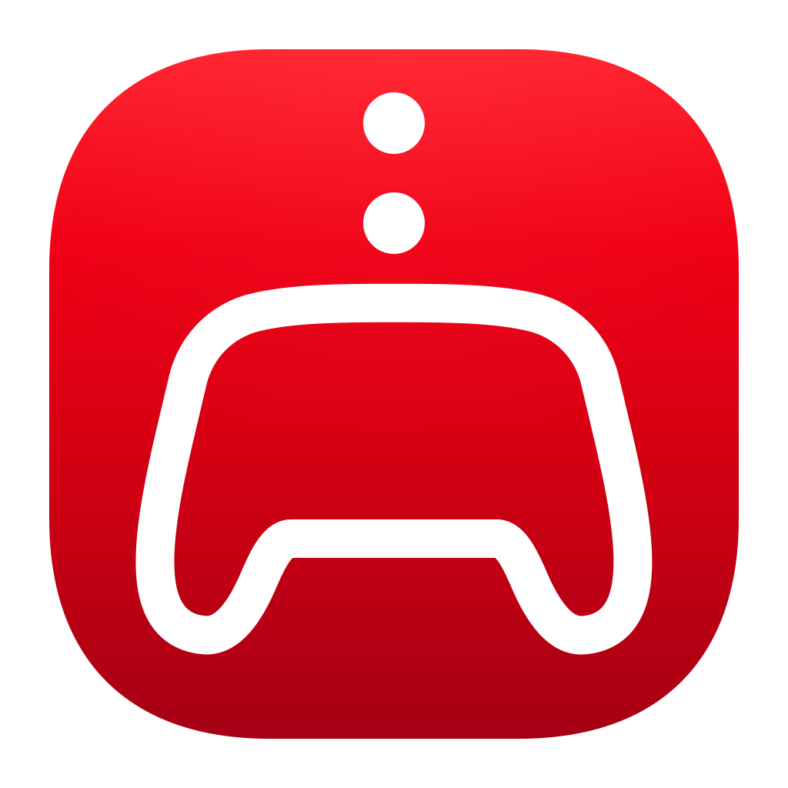

  

# InputRedirection for macOS

Use a controller connected to your Mac to play on your Nintendo 3DS over your local network.

Requires **macOS 13 or later**, a controller recognized by macOS, and a 3DS running **Luma3DS** with InputRedirection enabled.

## Get started

1. Connect your controller to your Mac using Bluetooth or USB.
2. Connect your Mac and 3DS to the same local network.
3. On your 3DS, open **Rosalina → Miscellaneous options → Start InputRedirection**.
4. Enter your 3DS IP address in the app, select your controller, and click **Start Sending**. Allow local network access if prompted.

If input does not respond, check the IP address, InputRedirection on the 3DS, and your Mac’s local network permission.

The app sends input only; it does not display 3DS video. C-Stick and ZL/ZR require a New Nintendo 3DS.

## Features

- Customize button and stick mappings, with settings saved for each controller type.
- Use the mouse as a stylus to control the 3DS touchscreen.
- Keep sending input while the app runs in the background.

Default face-button mappings follow Nintendo button positions. Available buttons and symbols depend on your controller and macOS.
